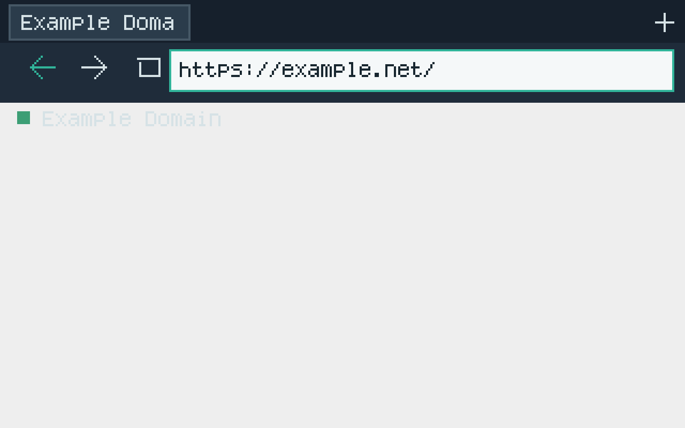
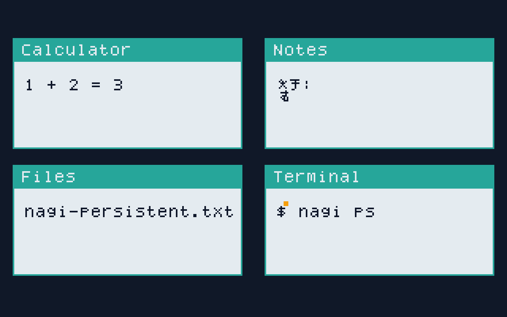
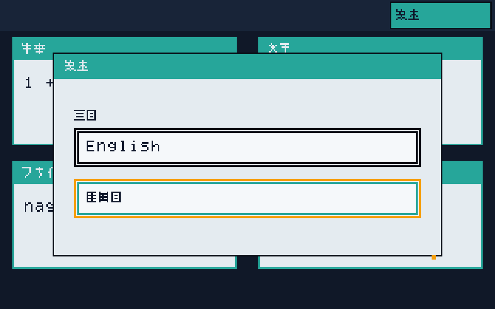

# Nagi OS

**NAGI — Native Agentic General Interface**

[English](README.md) · [日本語](README.ja.md)

Nagi は、明示的な権限、ネイティブデスクトップ、利用者の権限内で動く AI を
中心に開発している、独立したローカルファースト OS です。独自のカーネルと
ユーザー空間を持ち、Linux・Windows・macOS は開発ホストとして使用します。
0.1 Developer Preview の対象は QEMU x86-64 です。

**実験的な Developer Preview であり、完成した汎用 OS ではありません。**
所有者が権利を持つ Nagi 独自 OS ソースのうち、明示された範囲を
**MPL-2.0** で提供します。既存パッケージ・外部ソフトウェア・モデルの
ライセンスは維持します。字形・画像等の出自や OS イメージ全体の再配布確認は
未完了です。[ライセンス](#ライセンス)と[適用範囲](LICENSE_SCOPE.md)を参照してください。

## 開発理念

**安全を既定に。強力な操作は利用者の選択で。制限するのはソフトウェアであり、所有者ではない。**

Nagi は、利用者が意図を伝えつつ、自分のマシンを制御できるインターフェースを
探求します。AI を無効にしても GUI・キーボード・マウスで使えることが設計要件です。
中核機能はクラウドアカウント、クラウド LLM、API キー、テレメトリ、リモートストレージを
必須としない方針です。

AI はユーザー空間の信頼されないプロバイダーです。状態を変更する提案は、
決定的な検証、ポリシー、権限確認、実行器を通過する必要があります。
モデルの確信度から権限を付与しません。ローカル推論、意味的なオブジェクト、
履歴、Undo はこの設計の一部ですが、全体の統合はまだ進行中です。

英語と日本語は同等の第一級ユーザー言語として設計しています。
API・診断の正準言語は英語です。全画面のローカライズとアクセシビリティの
受け入れは未完了です。

## QEMU 上の Preview

以下は既存のゲスト受け入れ実行で取得した画面です。製品モックアップではありません。
各撮影時点の実装を示しており、ロードマップ全体の完成を示すものではありません。



*2026-10-01 に撮影した Albert / Servo の HTTPS 描画受け入れ画面。
2026-10-07 の M18 全対話シナリオの CI 完了より前のキャプチャです。*

| ネイティブデスクトップの受け入れ画面 | 日本語 Settings の受け入れ画面 |
| --- | --- |
|  |  |
| Calculator・Notes・Files・Terminal の固定パネル。完成したアプリ群ではありません。 | 言語選択・再起動の確認画面。全画面の翻訳完了を証明しません。 |

今回の準備ではデモ動画を公開していません。
[動画撮影計画](docs/oss/demo-recording-plan.md)に、既存のゲスト受け入れ証拠に
対応するショットと、撮影前に再確認する事項をまとめています。

## アーキテクチャと技術的特徴

```text
UEFI / OVMF → Nagi Loader → Nagi Kernel → nagi-init / Supervisor
                                            │
                         ユーザー空間サービスと Nagi SDK / PAL
                                            │
                         ネイティブアプリと Albert (Servo)
```

これは設計上の方向を示します。Preview の一部サービスは init 内で動いており、
図は全サービスの本番プロセス分離が完了していることを意味しません。

- **Capability ベースのハイブリッドカーネル:** 実行、メモリ、IPC、権限を
  カーネルが担い、ファイルシステム、ネットワーク、デスクトップ、音声、
  パッケージ、AI の高水準ポリシーはユーザー空間に置きます。
- **独自の実行基盤:** Rust、ELF64、Nagi ABI、バージョン付きサービス API、
  Rust/C SDK、Nagi PAL / relibc 互換境界を使います。
  POSIX は互換層であり、Linux カーネルの契約ではありません。
- **実際のブラウザーポート:** Albert は Servo を Nagi の Mesa Softpipe
  ソフトウェア描画経路で使用します。ホストブラウザーでゲスト処理を代行しません。
- **ローカル AI:** 型付きのプロバイダー能力で、決定的処理・判断・生成を分けます。
  0.1 の生成 LLM ランタイムは llama.cpp / GGUF、
  Standard の既定モデルは IBM Granite 4.2 3B です。
- **オブジェクトと復旧:** Object ID・Workspace をパスやプロセスと区別します。
  トランザクション、履歴、Undo、A/B 復旧には範囲を限定した受け入れ実装があり、
  より広い統合は未完了です。

契約と目標範囲は[アーキテクチャ概要](docs/architecture/README.md)と
[実装仕様](docs/Nagi_OS_0.1_Codex_Implementation_Spec.md)を参照してください。

## 開発状況

**2026-10-11 時点**、main の
`379d19eadb6f8792c27b9bc3f147e1ea48eac4a2` を基にした説明です。
[実装状態](docs/implementation_status.md)を正とします。
個別の受け入れ成功はマイルストーン全体の完了を意味しません。

| 領域 | 確認済みの証拠 | 残る制約 |
| --- | --- | --- |
| ブート・カーネル・ストレージ・表示／入力・ネットワーク・ABI・SDK | M0〜M17 は PASS と記録され、実 QEMU の受け入れ証拠があります。 | Preview 固有の上限や、記録済みの回帰・環境制約があります。 |
| Albert ブラウザー (M18) | PASS。[CI run 37601664873](https://github.com/Roy-To/NagiOS/actions/runs/37601664873)で、3つの HTTPS サイトと権限、クリップボード、かな IME、アップロード、利用者操作によるダウンロードを確認。 | 本番の呼び出し元認証、通知表示、StorageManager の永続化は制約あり。漢字変換は延期。ブラウザーサービスは同一プロセス内。 |
| Search／意味的レイヤー (M19) | PARTIAL。Object ID 永続化、ブラウザー履歴／Search 再起動、範囲を限定したサインイン済み Files 索引にゲスト証拠あり。 | 本番アプリ向けの有効な権限付き Search、Files 変更／ゴミ箱 UI、通常の履歴 producer ライフサイクルは未完了。 |
| ローカル生成 AI (M20) | PARTIAL。ローカル QEMU で実 Granite 推論とスキーマ制約付き日本語出力を記録。 | ホスト CI は推論前のストレージ書き込みで失敗。通常のモデル導入・遅延ロードサービス統合は未完了。 |
| Planner・Undo・ブラウザー文脈・埋め込み・音声・モデル routing (M21〜M26) | PARTIAL。検証器、限定ゲスト fixture、個別プロバイダーの実験あり。 | 汎用エージェント操作、ページ要約 UI、本番意味検索、マイクから操作までの音声体験は未完成。Qwen 推論と Gemma 利用の受け入れは未完了。 |
| 復旧・ストレス・仕上げ・リリース (M27〜M30) | PARTIAL。限定 A/B／復旧、再起動、言語、配布束の確認証拠あり。 | 全体統合、セキュリティ／翻訳／アクセシビリティ、人による再配布レビューは未完了。 |

物理ハードウェア、モバイル／複数デバイス実行、クラウド同期、完成したインストーラーは
将来の方向であり、受け入れ済みの 0.1 機能ではありません。
本番セキュリティの保証はありません。[SECURITY.md](SECURITY.md)を参照してください。

## ビルドと実行

対応する開発ホストに、固定された Rust ツールチェーン、QEMU、OVMF、
ビルド依存関係を用意します。[Developer Preview ガイド](docs/developer-preview/README.md)
にセットアップと診断をまとめています。ガイドの古い説明と異なる場合は最新の実装状態を確認してください。

POSIX ホスト:

```sh
./nagi fetch
./nagi doctor
./nagi build
./nagi test
./nagi image
./nagi run
```

Windows PowerShell:

```powershell
.\nagi.ps1 fetch
.\nagi.ps1 doctor
.\nagi.ps1 build
.\nagi.ps1 test
.\nagi.ps1 image
.\nagi.ps1 run
```

`fetch` はハッシュ／リビジョン固定の外部ソースとフォントを取得します。
ネットワーク接続と大きな空き容量が必要になる場合があります。
すべてのモデルが導入されたことは意味しません。`build`・`test` はホスト互換
パッケージが対象です。`image` が既定のゲストイメージを作り、`run` が起動します。
機能別の受け入れイメージは別です。`./nagi --help` に `m18`・`login` などの一覧があります。

参照 VM: QEMU x86-64、UEFI/OVMF、q35、4 vCPU、8 GiB RAM、
VirtIO Block/Network/GPU/Sound/RNG、ソフトウェア描画。
物理 PC 対応は 0.1 の完了要件ではありません。

PowerShell のポリシーでスクリプトが拒否される場合、受け入れ手順では次を使います。

```powershell
powershell.exe -NoProfile -ExecutionPolicy Bypass -File .\nagi.ps1 doctor
```

## 貢献と公開準備

実装変更の前に [AGENTS.md](AGENTS.md)、仕様、実装状態を確認してください。
[CONTRIBUTING.md](CONTRIBUTING.md)は検証手順、
[SDK ガイド](sdk/README.md)はサンプルのパッケージ化を説明します。
再現可能なゲスト不具合、範囲を絞ったポート、ドキュメント修正、証拠に基づく
レビューを歓迎します。

このドキュメントは OSS 公開と Codex for Open Source 応募の準備です。
[応募準備メモ](docs/oss/codex-application-preparation.md)に、プロジェクト説明、
支援の用途、maintainer が確認する事項をまとめています。
応募の送信や採択を示すものではありません。

## ライセンス

所有者が権利を持つ Nagi 独自 OS ソースのうち、[LICENSE_SCOPE.md](LICENSE_SCOPE.md)
に記載した対象を **[MPL-2.0](LICENSE)** で提供します。単なる採用候補ではなく、
対象ソースへの利用許諾です。ただし、リポジトリ内の全ファイルや OS イメージ全体が
MPL 対象・再配布確認済みという意味ではありません。

`tools/nagi-cli`、`tools/legal`、`crates/nagi-embedding-provider`、
`crates/nagi-tts-provider` の既存 `MIT OR Apache-2.0` 表記は維持します。
第三者ソフトウェアやモデルにも元の条件が残ります。Granite・Qwen の対象モデルは
Apache-2.0 と記録されていますが、Gemma は Google 独自規約です。
今回のライセンス整備ではモデル重みを配布しません。

埋め込み字形の出自が未確認の `user/nagi-init/src/font.rs` や画像・データ類は、
今回の新たな許諾に含めません。[レビュー記録](docs/oss/mpl-2.0-scope-review.md)に、
確認した資料、確認できなかった範囲、未解決事項を明記しています。
OS イメージ・ソース一式の再配布確認と 0.1 の完成判定は、引き続き別の作業です。

[THIRD_PARTY_NOTICES.md](THIRD_PARTY_NOTICES.md)と
[過去の Apache-2.0 準備監査](docs/oss/apache-2.0-readiness.md)の依存関係に関する
指摘は残ります。過去の Nagi 本体のライセンス候補に関する記述だけを
LICENSE_SCOPE.md で更新し、未解決の出自・通知義務まで解決扱いにはしません。

その他: [ロードマップ](ROADMAP.md) · [リリースノート](RELEASE_NOTES.md) ·
[依存関係／SBOM ツール](docs/legal/README.md)
