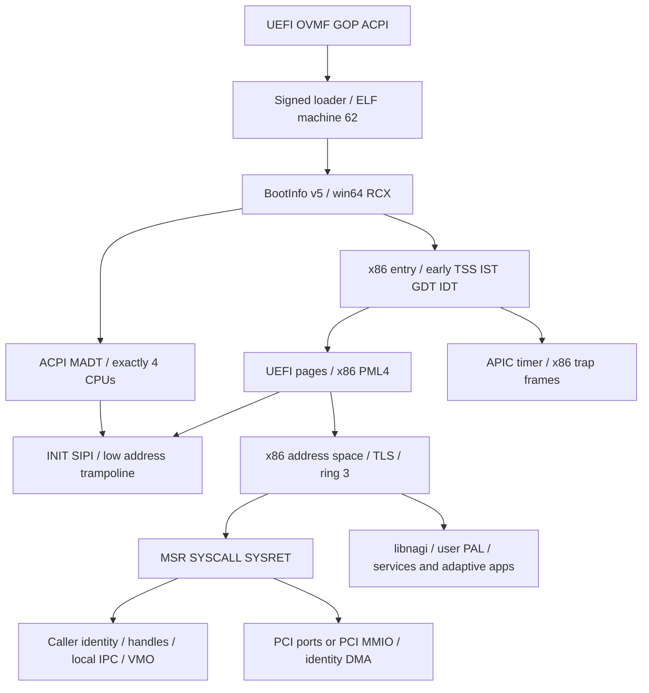

# PORT-MULTIARCH-01 — live audit

Audit date: 2026-10-11. Baseline: `379d19eadb6f8792c27b9bc3f147e1ea48eac4a2` (`origin/main` after fetch).
Dedicated worktree: `/workspace/worktrees/port-multiarch-foundation-01`.
Branch: `codex/port-multiarch-foundation-01`. Initial original worktree was
clean at the same SHA on `work`; it remains untouched.

## Authority and scope

The current user requested implementation and verification of A/B and, where
independent ownership permits, C. The attachment supplies the work plan and
explicitly excludes production edits without the existing gate. This is not an
os-core exception. [Registration proposal](registration-proposal.json) is
unapplied and the state here is **provisional/unregistered**.

[docs/implementation_status.md:5](https://github.com/RT-NISH/NagiOS/blob/379d19eadb6f8792c27b9bc3f147e1ea48eac4a2/docs/implementation_status.md#L5) records M19–M30 PARTIAL;
M18 is PASS. [.dev/workstreams.json:141](https://github.com/RT-NISH/NagiOS/blob/379d19eadb6f8792c27b9bc3f147e1ea48eac4a2/.dev/workstreams.json#L141) assigns
`kernel/**`, BootInfo and ABI to unassigned `os-core` on `codex/0.2-os-core`,
requiring M30 PASS and a bounded Integration Owner milestone/ABI contract.
There is no os-core state/remote branch or port-specific checkpoint. The
integration owner has broad `docs/**` integration rights but does not own
kernel/loader; new proposal documents here do not amend canonical status,
accepted ADRs, registry, CI or root Cargo files. Independent experiment paths
have no owner row or existing implementation in any inspected remote tree.

The older integration-next-phase state still discusses M17 BLOCKED. That is
stale relative to live 0.1 status, so it cannot downgrade M18 or open M30.
`origin/codex/integration-next-phase` is
`3c68babcdf02563618c2ed60a1a363d6b1141470`; its live 0.1 summary also keeps
M30 PARTIAL. Current main is the non-invasive independent base; no unpublished
owner histories were imported or branches merged.

## Concurrent work and findings

[Remote refs](evidence/remote-refs.txt) and [PR snapshot](evidence/pr-snapshot.json)
record all fetched branches and the API's returned repository PR history.
Open #42 (Files recovery), #43 (ordinary session release gate), #48 (Desktop AI)
retain unfulfilled guest acceptance. #54 (FAT32), #45/#41 (voice/embedding),
#53/#55 (host foundations), #56 (OSS docs) are separate active responsibilities.
Merged #2/#3 require preservation of entry/per-CPU TSS/IST failures; #13/#14/#17
require signed boot/update and sign-in readiness. No architecture port PR or
experiment was found. No remote branch was pruned, force-pushed, rebased or deleted.

[Authority hashes](evidence/authority-sources.json) pin the read AGENTS/specs,
0.2 ownership/rules, 0.3 design intent, accepted hybrid-kernel ADR and unified
application/node model. 0.3 is design guidance only, not runtime authorization.

## Dependency graph

Every node is anchored in [the matrix](portability-matrix.md); the machine
inventory records matching file/line/source text and SHA-256. Critical ordering:
freeze semantic acceptance → console/CPU primitives → MMU/map attributes →
trap/context/syscall boundary → firmware/topology → transport/DMA. A later
approved x86 extraction can follow this order; C has no dependency on that code.

## Audit limit

Static matches are not a proof that every indirect upstream or runtime assumption
has been found. The explicit unknowns in the matrix need target experiments under
later checkpoints. Phase A PASS covers the enumerated live repository audit;
it grants no hardware, M30, Nagi ARM64 or product acceptance.
